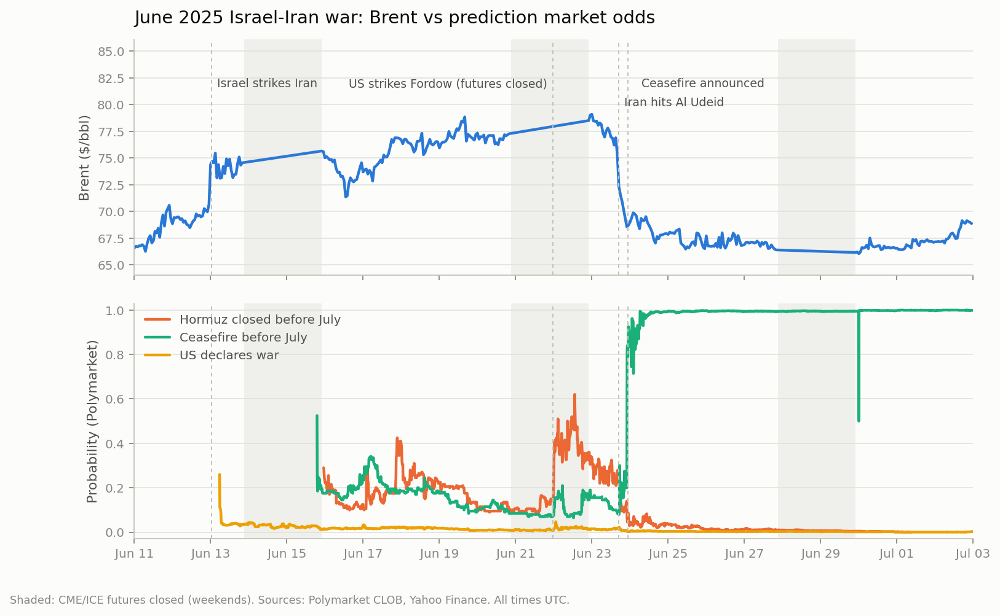
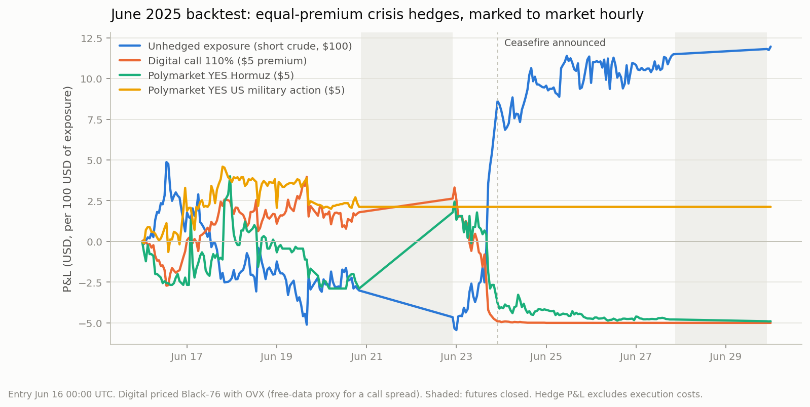

# Hedging oil geopolitical risk with prediction markets

**Can a desk hedge event-driven oil risk (a Hormuz closure, strikes on Iran, sanctions) with prediction market contracts instead of options? I tested it on the June 2025 Israel-Iran war, hour by hour, and I am recording the ongoing 2026 Hormuz crisis to test it again with real order book depth.**

The bridge between the two worlds is simple. A Polymarket contract is a digital option on an **event**. An OTM call spread on Brent is a digital option on **price**. Between them sits the conditional impact of the event on the price. This repo builds that bridge and measures where it holds and where it breaks, using only free data.



## TL;DR: five findings

1. **Prediction markets were the only hedging venue on Earth for 50 hours.** The US strike on Fordow came on a Saturday night with oil futures closed all weekend. Polymarket quoted continuously: Hormuz closure odds went 0.10 to 0.50 and back to 0.30, and the Sunday reopen gapped only +1.6%. Weekend coverage is a use case listed options cannot replicate.
2. **At equal premium, the event contract was not the cheaper hedge.** Even entering at OVX 57%, a Black-76 digital call marked +51% at the peak exit vs +27% for the Hormuz contract. In a full-blown crisis, fear is priced everywhere; "prediction markets are cheap insurance" did not survive contact with the data.
3. **An event contract is a scenario hedge, not a continuous one.** In minimum-variance hourly hedging, the price digital removes 58% of the exposure's variance; the Hormuz contract removes 13%. It covers a discrete state of the world, not the path.
4. **The resolution criterion dominates everything.** Two "US attacks Iran" contracts, $5 each: the broadly-worded one resolved YES at Fordow and returned +135%; the narrow "officially declares war" one sat at 1-2% through actual B-2 strikes and returned -100%. Same military reality, opposite hedges.
5. **Basis risk runs both ways, and exit discipline beats instrument choice.** On June 23 Brent fell 7% in 5 hours after Iran's symbolic Qatar strike while ceasefire odds stayed under 0.21 until Trump's announcement. Every hedge was profitable at the peak; three of four were worth zero eight days later, while the exposure itself had flipped positive.

## The backtest

A crude consumer holds $100 of short-crude exposure (loses 1% per 1% Brent rally). On June 16, 2025, 00:00 UTC it spends an **identical $5 premium** on each of four crisis hedges and holds to June 30, with an alternative exit at the Brent peak.

| Instrument | Entry price per $1 payout | Peak exit (Jun 23) | Held to resolution (Jun 30) |
|---|---|---|---|
| Digital call on Brent, strike 110%, Black-76 with OVX | 0.180 | **+51%** | -100% |
| Polymarket YES "Iran closes Strait of Hormuz before July" | 0.225 | +27% | -100% |
| Polymarket YES "US military action against Iran before August" | 0.425 | +42% | **+135%** (resolved YES) |
| Polymarket YES "US officially declares war before July" | 0.013 | +19% (illusory: 1-3c market) | -100% |

For reference, the unhedged exposure was at -5.44 at the peak and +11.96 at expiry: Brent ended below its entry level, so the books that held to maturity paid for protection they no longer needed. An event hedge is managed like a position, not like insurance you forget.



<details>
<summary><b>Measured chronology of the episode (UTC)</b></summary>

| Time | Event | Event markets | Brent |
|---|---|---|---|
| Jun 13 ~00:30 | Israel strikes Iran | "Iran strike by Friday" 0.57 to 0.88 overnight | +5.3% in 1h |
| Jun 17 | escalation, US involvement rumors | Hormuz 0.10 to 0.34 | 75-77, OVX 34 to 72 |
| Jun 21 23:30 (Sat) | B-2s strike Fordow | "US action before August" resolves YES from 0.86; Hormuz 0.10 to 0.50 | **futures closed** |
| Jun 22 22:00 | futures reopen | Hormuz ~0.30 | gap +1.6% (77.27 to 78.50) |
| Jun 23 17:00 | Iran hits Al Udeid, symbolic | Hormuz 0.24 to 0.14 | -4% in 1h |
| Jun 23 17:00-20:00 | market reads de-escalation | ceasefire still 0.10-0.21 | drifts to 70.13 |
| Jun 23 ~22:00 | Trump announces ceasefire | ceasefire 0.21 to 0.85 in 1h | 68.55 |
| Jun 24-30 | back to calm | Hormuz to 0; ceasefire 0.95+ | back to pre-war 65-67 |

Other measured facts: correlation of hourly changes dP(Hormuz) x Brent return is +0.31 in the same hour and insignificant at every lag from -6h to +6h, so neither market systematically leads at this frequency; the same-hour conditional impact is +0.84% of Brent per +10pp of Hormuz probability (OLS, n=249). The edge of event markets is scenario granularity and trading hours, not speed.

</details>

## Live dataset: the 2026 Hormuz crisis

The US blockade of Iran (July 2026) and the Hormuz traffic disruption are ongoing. Since November 3, 2026 an hourly collector (`src/collect_live.py`, Windows scheduled task) snapshots **59 open Polymarket markets**: Hormuz traffic normalization (resolved on IMF PortWatch ship counts), end of the blockade, US-Iran ceasefire, invasion, WTI price ladders, Venezuela. For each market: last price, best bid/ask with sizes, depth within 5 cents of mid, plus a gzipped top-10 book dump, and alongside: WTI, Brent, OVX (121 at the 2026 peak; 63 in early November).

That fixes the main weakness of the June 2025 study: no historical bid/ask exists for Polymarket, so past execution costs are unknown. The live data makes the next backtest executable-price-aware. First snapshot for flavor: "Hormuz traffic back to normal by Dec 31" at 11-12% with 300,000+ shares within 5 cents of mid.

## Data and method, all free

| Need | Source | Granularity |
|---|---|---|
| Event probabilities, 193 oil-relevant markets since 2023 | Polymarket Gamma + CLOB APIs | full daily history on closed markets; 10-min in windows |
| Hormuz ship counts, EIA inventories, WTI/Brent ladders | Kalshi trade-api v2 | OHLC bid/ask candlesticks |
| WTI (CL=F), Brent (BZ=F) | Yahoo chart API | daily 3y+; hourly on episodes |
| Crude implied vol (OVX) | CBOE public CSV | daily since 2009 |

Known gap, stated rather than hidden: no free historical option chains for Brent/WTI. The options leg is a Black-76 digital priced with OVX, which a real call spread (skew, bid-ask) would make more expensive, so the comparison if anything flatters the options side.

<details>
<summary><b>Reproduce it</b></summary>

Python 3, stdlib + curl for data (matplotlib only for the charts). No API keys.

```
src/fetch_data.py       CLI: polymarket-search / polymarket-history / kalshi-candles / yahoo / ovx
src/analyze_episode.py  builds merged_hourly.csv, prints chronology, lead/lag, impact betas
src/backtest_hedge.py   the four-hedge backtest, writes hedge_paths.csv
src/plot_episode.py     first chart
src/plot_backtest.py    second chart
src/collect_live.py     hourly collector (run once, or --loop 3600)
src/watchlist.json      the 59 live markets
data/episode_jun2025/   10-min odds, hourly Brent/WTI, OVX, merged grid, charts
data/live/              collector output (not committed, grows hourly)
```

Useful API facts found along the way: Polymarket's `prices-history` serves full daily history on closed markets with `interval=max&fidelity=1440`, and intraday down to `fidelity=10` through `startTs/endTs` windows of up to ~5 days; Kalshi's old settled geopolitical markets (e.g. KXCLOSEHORMUZ-25JUL) are not listed by the unauthenticated public API, while its candlesticks endpoint works fine on listed ones.

</details>

## Honest limitations

- One episode, ~250-300 hourly observations: the betas and variance reductions are orders of magnitude, not parameters.
- Polymarket P&Ls assume execution at the last print; depth at the touch is unknown for 2025 (being fixed by the collector for 2026).
- The digital hedge is modeled, not traded.
- Minimum-variance ratios are in-sample.
- Event contracts have short horizons: a standing hedge pays roll costs this study does not model.

## Roadmap

1. Re-run the backtest on the 2026 crisis with real bid/ask and depth from the collector.
2. Calibration chapter: are Polymarket's geopolitical probabilities reliable in level, not just direction? (Extends my [kalshi-calibration](https://github.com/nalimmm/kalshi-calibration) work.)
3. Curve chapter: prompt spreads from per-maturity CME settlements, since a supply shock moves the front of the curve first.

---

*Free data only; nothing here is investment advice.*
